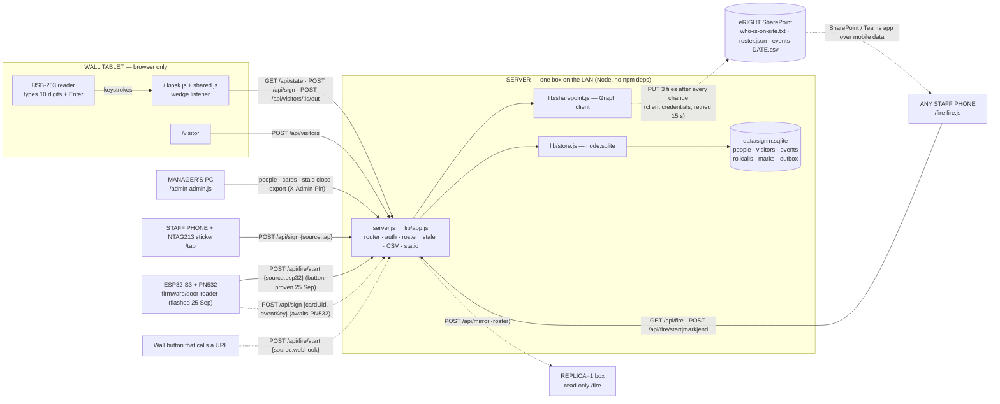

# eRIGHT Sign-In v4.1 — staff & visitor register with fire roll call

Small LAN system for a single door: 8 staff, visitors, and — because eRIGHT has **no designated
fire marshal** — a register that anyone at the assembly point can open on a phone and that is
copied off-site automatically after every change. Node 22.13+ only; no npm dependencies, no build
step. Data is SQLite (Node's built-in `node:sqlite`).

Built 2026-09-25 from the original SigninApp (`tobygladman2/SigninApp` commit `6eab63a`, shared-server
kiosk) plus the useful bits of the separate Home Presence project: SQLite persistence, event IDs for
idempotent retries, API tokens for devices, a mirror/replica, an ESP32 door reader, and a device column
on every event. The v3.0 rewrite deliberately left out camera motion, BLE presence, geofencing and the inferred
"auto-away" sign-out. v3.4–3.6 later added phone and key-tag presence, but only under the rules in
"Presence": inference may sign people **in**, may only undo its own sign-ins, and never overrules a person
who tapped. Camera motion and geofencing are still out.
The original one-file JSON version is preserved in git history (`git show 6eab63a:server.js`).

## Where things stand (2026-09-27)

| Piece | State | Evidence |
| --- | --- | --- |
| **Server** v3.6 | **LIVE** on Proxmox CT 106 `signin` (Ubuntu 24.04 LXC), `http://192.168.101.102:3000` | `/api/health` 3.6.0 at 21:35Z 2026-09-27 (upgraded from 3.3.0 with `deploy/upgrade-ct106.sh`; db copied to `/root/signin-pre-upgrade-*.sqlite` first); `signin_wifi_enabled 0` until the UniFi key is set |
| **Server v4.1** (see "v4.1") | **LIVE on CT 106 since 2026-10-19 22:48Z** (`ef6b878`; pre-upgrade db `/root/signin-pre-upgrade-20261019T224833Z.sqlite`, env backup `/root/eright-signin.env.pre-v41`; schema v11) | 69/69 tests on the box before the restart; every health check ok; first off-box push `aiadmin@192.168.102.100:signin-Mon.sqlite` 22:48:55Z; restore drill ok (integrity ok, schema 11, 0 drift, 73 events); checkout pulls over the read-only deploy key; Caddy v2.11.7 test on the box: allow-list holds, outside `/api/fire` has no company/host/vehicle/badge, key and PIN 0 times in its log |
| **Server v4.0** (see "v4.0") | **LIVE on CT 106 since 2026-10-19 20:36Z, v4.0.1 since 21:02Z** (`aaaff37`; pre-upgrade db `/root/signin-pre-upgrade-20261019T203605Z.sqlite`, env backup `/root/eright-signin.env.pre-v4`; schema v9; `RETENTION_DAYS=2190`, assistant on fast-a) | 55/55 tests on the box; `signinctl status` all checks ok; every page 200; the live `attendance_current` projection equals a fold of the pre-upgrade event log (9 subjects); retention's first run touched nothing; a real question answered by fast-a from a tool call in 11 s |
| **Server v3.7** (audit fixes, foundations, device tokens, admin sessions, audit trail, live screens; see "v3.7") | superseded by v4.0 (was live 18:30Z–20:36Z 2026-10-19) | |
| **Door-reader firmware v4.1** (network task, heartbeat, BLE off by default; includes v3.7 fire-button retry + offline tap queue) | **compiled, not yet flashed** | `pio run` 2026-10-19: BLE off RAM 14.3 % / flash 26.6 %, BLE on RAM 15.6 % / flash 29.9 %; CI builds both |
| **Presence — Wi-Fi brace** | built + tested; **off** until `UNIFI_URL` + read-only `UNIFI_API_KEY` are in `/etc/eright-signin.env` | startup log: `presence: Wi-Fi brace off` |
| **Presence — BLE brace** | server side live (`/api/presence/ble`); back-door firmware with the NimBLE scan **compiled, not yet flashed** (board off the lead); no tags bought yet; anchor ESP32 not yet built | `deploy/demo-presence.ps1` drove the full walked-in sequence locally 2026-09-27 |
| Staff names, company, fire notice | **not yet entered** | Admin → PIN (from the install log) |
| **Teams webhook** | **live** — URL set 2026-09-30, END card landed in eRIGHT › General 2026-10-01; cards name who is on site / not accounted for | regenerate the URL (sig was pasted in chat), re-set in `/etc/eright-signin.env`. **Depends on the Proxmox box, LAN and fibre all being alive at the moment START/END is pressed** — see "What actually survives the fire today" |
| **SharePoint copy** | built + tested against a fake; **tenant not yet configured** | `SP_*` lines |
| **Prometheus / e-mail alerts** (llm-cluster) | rules + scrape job in repo; **deploy on platform-a owed** (`SIGNIN_ADDR=192.168.101.102 bash scripts/deploy-signin-monitoring.sh`) | platform-a reaches the server (`signin_up 1` read from it) |
| **Back-door reader** (ESP32-S3 + PN532) | firmware flashed as `back-door-reader`; Wi-Fi + health 200 + **fire button proven** (roll call 09-25 22:58Z) + **cards read 09-27 20:34Z** (`C3621F39`, `314F6C0A` as unknown_card) — assign them in Admin | `firmware/door-reader/WIRING.md` |
| **Front-door kiosk** (Pi 5 + Argon HMI 10CS, PoE) | **parts ordered 2026-09-26, £234.30**; installer written, unverified on hardware | "Door kiosk — Raspberry Pi build" |
| USB-203 card reader | output format verified; kiosk end-to-end owed (with the Pi) | "Card reader — what has been verified" |
| DHCP reservation for `.101.102` | owed (UniFi) | keeps `/etc/hosts` on platform-a true |

## Repository and history

| Commit | Date | What |
| --- | --- | --- |
| `6eab63a` | 2026-09-23 | Toby Gladman's original SigninApp: one JSON file, kiosk, admin, NFC `/tap` |
| `9fd70dc` | 2026-09-25 | Read-only `/rollcall` page and amber "signed in before today" flag added to the original |
| `588942d` | 2026-09-25 | Full v3 rewrite: SQLite, visitors, fire roll call, cards, mirror, admin PIN, tests |
| `b0c1c6f` | 2026-09-25 | README: history table and first-run checklist |
| `bf3ec40` | 2026-09-25 | README: card reader identified and verified facts recorded |
| `bfb38e9` | 2026-09-25 | v3.1: SharePoint off-site copy via Microsoft Graph, per-sink outbox |
| `0836ed2` | 2026-09-25 | README: v3.1 no-marshal framing, data-flow diagram, health fields |
| `4712791` | 2026-09-25 | v3.2: Prometheus `/metrics` (counts only), lone-worker flag, ALL SAFE state — so the estate's Prometheus/Alertmanager on platform-a watches the register (see "Estate integration") |
| `05a94db` | 2026-09-25 | v3.3: **Teams webhook** (roll-call start / all-safe / end cards in seconds), **visitor pre-registration** (one-tap arrival), kiosk **lone-worker banner**, new estate-wide design, `deploy/install-ubuntu-vm.sh` |
| `b764fd7` | 2026-09-25 | tests pin every env-derived setting (an exported `ADMIN_PIN` in the shell had turned a run red) |
| `2a5bfe8` | 2026-09-25 | README: step-by-step Ubuntu install for the Proxmox VM |
| `6acdf1e` `cea6d33` | 2026-09-25 | installer pipefail fix; **first live install** on Proxmox CT 106 `signin` (192.168.101.102) |
| `f3120c8` `636cd94` | 2026-09-25 | **Door-reader firmware built and flashed for the first time** (ESP32-S3): bench-tolerant PN532, health check, steady LEDs, dual log; `WIRING.md` build guide; fire button proven live |
| `ccf7a13` | 2026-09-26 | README: ESP32 flash / test / LED section |
| `aa5682e` | 2026-09-26 | **Door kiosk = Raspberry Pi** (no battery, PoE, cage + Chromium): `deploy/kiosk-pi/install.sh`, parts list and build steps; kiosk page accepts a one-time `?cardToken=` hand-in |
| `a1343b8` | 2026-09-26 | **Decision: ESP32 + PN532 = back-door reader + fire button** (`back-door-reader`, reflashed); front door = Pi kiosk + USB-203. Two independent tap points, no new code |
| `0f6c99e` | 2026-09-26 | **Kiosk parts ordered** (The Pi Hut, £234.30): Pi 5 2 GB, Argon Industria HMI 10CS 10" display + enclosure, Argon PoE+ HAT, THRML cooler, SD. Build steps match the kit; installer copes with Desktop images |
| `7b998b0` | 2026-09-26 | README: history + current-state summary |
| `a7b09ac`…`f09c953` | 2026-09-27 | PN532 arrived; WIRING.md/.html with photos; **first real cards read** (back-door reader) |
| `6558a2f` `de10b26` | 2026-09-27 | **v3.4–3.6 Presence**: Wi-Fi brace (UniFi client list) + BLE brace (key tags heard by door/anchor scanners), direction from scanner sequence, auto sign-in, badge-not-act on absence, auto sign-out only when inference undoes inference and both braces agree; ESP32 firmware BLE scan; Pi BLE scanner; enrolment pickers. **Live on CT 106 21:35Z** via `deploy/upgrade-ct106.sh` |
| `5e0b842` | 2026-10-19 | **v3.7 audit fixes + foundations + device tokens + admin sessions + live screens** — see "v3.7: audit fixes and foundations". **Live on CT 106 18:30Z** |
| `41f1dec` `671136b` `ef6b878` | 2026-10-19 | **v4.1** — marks as events, one write path, off-box backup, restore drill, outside checks + heartbeat, trusted networks, fragment safe links, List ticks, chaser, reader network task, test-gated install with rollback, browser e2e; two review rounds — see "v4.1". **Live on CT 106 22:48Z** |
| `7a459d5` `0a7829d` `aaaff37` | 2026-10-19 | **v4.0 / v4.0.1** — route table, event-sourced attendance, persisted sessions, drills, self-marking, offline fire page, Microsoft List sink, retention, register assistant, `signinctl`, firmware NVS queue — see "v4.0". **Live on CT 106 20:36Z** |

Home: `https://github.com/otherlands/SigninApp` (remote `fork` in the development clone). The original
`tobygladman2/SigninApp` was disconnected from the development clone on 2026-10-19 and is no longer updated.
Developed for eRIGHT Ltd, 8 staff, one door.

## v4.1 (2026-10-19/20)

Built from the third full audit (findings C1–C12, an 18-step plan). Everything below is in commits `41f1dec`, `671136b`
(fixes from an independent review) and `ef6b878` (fixes from the re-review). What still needs a person, a console or a
decision is in `docs/go-live-guide.html` (and its PDF), marked as yours.

**Life-safety core**
- **Roll-call marks are events.** Every SAFE / MISSING / clear is written to the event log with the roll call it
  belongs to (`events.ref`) and who made it (`events.actor`), and `rollcall_marks` is rebuilt from the log like
  attendance (schema v11; the migration backfills both columns for existing marks). The last *written* mark wins,
  live and on rebuild, so a wall clock stepping back can never hide a later MISSING. `POST /api/projections/rebuild`
  reports drift for marks too.
- **One write path** (`lib/commands.js`): sign in/out, visitor arrival/departure, roll-call start/mark/end and stale
  closing are the only code that writes register facts, each in a transaction (`store.withTx`, nested via savepoints);
  notifications go out after commit.
- **"I'm SAFE" key in the link's #fragment** (`/safe#k=…`): browsers never send a fragment, so the key is in no server
  or proxy log; the page sends it only in an `X-Safe-Key` header and keeps it in the address bar so "Add to Home Screen"
  keeps it. `?k=` is no longer accepted by the API. The fire page has its own `fire.webmanifest` (start URL `/fire`).
- **Outside the office, names and marks only**: `/api/fire` from the proxy (or an untrusted network) carries no
  company, host, vehicle or badge.
- **Roll-call chaser**: while anyone is unaccounted for, the names are re-posted to Teams every `CHASER_MINUTES` (3)
  up to `CHASER_MAX` (10) times.
- **Microsoft List ticks** (two-way): a `Tick` choice column (SAFE / MISSING) is a one-shot command — the server reads
  it every 30 s during a roll call, applies it as a mark (`via list`, "<name> (Microsoft List)") and clears it. A List
  tick may always say MISSING; it may say SAFE only for someone nobody else has marked; a SAFE already in the List when
  the roll call starts (read at once) is discarded and stays discarded until its clear succeeds. **Pinned against a
  fake Graph only; not yet run against the real tenant.** Residual, recorded: an edit made offline in the Lists app
  during one roll call and synced during the next would look like a new tick.

**Ops and resilience**
- **Off-box backup**: after every backup, `rsync` over ssh to `BACKUP_PUSH_TARGET` as `signin-<Weekday>.sqlite`
  (seven rolling copies), with a pinned host key and a key that the target restricts to write-only into one directory.
- **Weekly restore drill**: the newest backup is copied to a scratch file, opened, integrity-checked and refolded;
  any drift or corruption fails the `restore-drill` health check. `POST /api/restore-drill/run` runs it now.
- **Outside checks** (hourly, `lib/ops.js`): LAN and public DNS for the public name, certificate days left, SharePoint
  secret expiry (`SP_SECRET_EXPIRES`), and devices that have gone silent (`EXPECT_DEVICES`; readers now `POST
  /api/heartbeat` every 5 min). A change (bad or recovered) posts once to a separate **ops** Teams channel
  (`OPS_TEAMS_WEBHOOK_URL`). `HEARTBEAT_URL`: the server pings an outside watcher every `HEARTBEAT_MINUTES`.
- **`TRUSTED_NETS`**: LAN addresses outside these subnets get only what the internet gets (fire page, assembly view,
  self-marks) plus device routes *with a token*; never Admin or token-less kiosk/marshal writes. A request that came
  through the local Caddy is judged on the client's address, not on loopback.
- **SSE caps**: `STREAM_MAX` (300) in total, `STREAM_MAX_PER_IP` (4) from outside.
- **Assistant**: model unreachable = 503 with a plain message (was 500) and an `llm` health check probed every 10 min;
  tool output is sanitised (control characters stripped, strings capped) and the prompt treats it as data.
- **Presence is OFF by default** (`PRESENCE=on` to use it); with it off no Wi-Fi/BLE job runs and BLE posts get 409.
  The Pi BLE scanner (`deploy/kiosk-pi/ble-scanner.py`) was removed.
- **Caddy log filter**: `X-Safe-Key`, `X-Admin-Pin`, `X-Api-Token`, `X-Mirror-Token` and a `?k=` query are deleted
  from Caddy's request log. Validated with Caddy v2.11.7 on CT 106: the secret and the PIN appear 0 times in the log.
- **Installer gates on tests**: a failing test puts the checkout back and restarts nothing.
  **`upgrade-ct106.sh` rolls back**: if the new version does not answer `ok:true` with the new version number within
  30 s, the previous commit *and* the pre-upgrade database snapshot go back (a newer schema is refused by older code).

**Screens**: Admin's health block opens with a one-line verdict (all checks pass / which fail) and shows off-box
backup, restore drill, heartbeat, assistant and presence; per-person **History**; **Give last tapped card** (no
copy/paste). Kiosk: **name search** (a card swiped into the box is still treated as a card).

**Door reader firmware**: every HTTP call (taps, fire start, BLE batches, health check, heartbeat) runs in one FreeRTOS
task on core 0; `loop()` only reads the button and the PN532 and drives the LED, so a dead server can no longer make
the button or the reader unresponsive. Queued taps drain at full speed; orange means "not delivered yet" at once (no
late flashes). `BLE_SCAN 0` is the new default. Both variants compile (BLE off: RAM 14.3 %, flash 26.6 %; BLE on:
RAM 15.6 %, flash 29.9 %); **not flashed** (no ESP32 on a serial port of this PC).

**Repository**: `main` is protected against force-push and deletion (enforced for admins; no required checks).
`package.json` is `eright-signin` 4.1.0. CI adds a browser end-to-end job and builds both firmware variants.

**Tests**: 69 (`test/v41.test.js` adds 13: marks as events + rebuild, transactions, assembly view, SSE caps, trusted
nets, off-box push and its failure, restore drill incl. a corrupt file, heartbeat + silent device + ops alerts, chaser,
List ticks incl. leftover and 412 cases, LLM down, presence off, and the review regressions). **Browser end-to-end**
(`npm run e2e`, headless Chrome/Edge over the DevTools protocol, no packages): kiosk search + tap; marshal tick;
`/safe#k=` self-mark with the key never in any request URL; and the **offline fire page** — server stopped, page
opens from the service worker with the last register, a tick is queued and lands when the server returns. Passing
locally (Edge) and in CI (Chrome). A copy of the live CT 106 database (v10) migrated to v11: integrity ok, zero
drift, attendance identical, marks identical except `via` filled in as `fire-page` on two pre-v8 marks (which the app
already read as `fire-page`). The full suite also passed on CT 106's own Node 22.23.3.

**Reviews**: an independent review of the v4.1 diff found six defects (TRUSTED_NETS bypassable through Caddy; a
List tick from an earlier roll call could mark someone SAFE; marks ordered by wall clock; retention leaving events
that broke a rebuild; the rollback skipped when the installer failed after restarting; no LED feedback for a tap
queued behind a stuck one). All fixed and pinned by tests; a re-review confirmed four and found two gaps (a discarded
List SAFE returning after a failed clear; a false orange / 5 s pacing in the reader), both fixed.

## v4.0 (2026-10-19)

Built from the second full audit. Decisions were put to Alan as nine questions on 2026-10-19; the answers, and the
facts checked against them, are recorded here so nothing below is assumed.

| Question | Answer | What was checked | What v4.0 does |
| --- | --- | --- | --- |
| HTTPS | A real name: **signin.eright.co.uk** | **Does not exist in public DNS** (eright.co.uk is on GoDaddy nameservers ns13/ns14.domaincontrol.com). Inside the LAN the UniFi gateway answers **192.168.101.168 — a host that does not exist** (no ping, no ports). Nothing listens on 80/443 on CT 106. Public address seen from the office: 46.37.62.121. | Native TLS in the server (`TLS_CERT_FILE`/`TLS_KEY_FILE`/`TLS_PORT`, HTTP stays), `deploy/Caddyfile` + `deploy/install-caddy.sh` for the name, ready to run **after** the A record / port-forward (or DNS-01) and the LAN DNS fix exist. **Not enabled on CT 106**: with nothing resolving it would only break the kiosk and QR codes. `PUBLIC_URL` stays the LAN address until the name works. |
| Event-sourced core | Yes, in place (strangler) | — | The `events` table is the **write-path truth for attendance**: every `in`/`out` updates the `attendance_current` projection (and the visitor row) in the same transaction. "Who is in" is one read. `POST /api/projections/rebuild` refolds from the log and reports drift; `GET /api/register?at=` is time travel ("who was in at 14:32"). People, expected visitors, devices and settings stay as reference tables (they are not the register). Roll-call marks keep their table for now. |
| Off-site ticking | **Microsoft List** via Graph; Alan creates the Entra app registration | `SP_*` still unset on CT 106 | `lib/mslist.js`: one list, one row per person on site + a `_status` row, patched/added/deleted to match on every change (`SP_LIST` + the SP_* vars). Pinned against a fake Graph; **not yet run against the real tenant**. Editing rows there to tick people is the next step once the tenant exists. |
| Phones off Wi-Fi | Yes, via signin.eright.co.uk | see HTTPS: not true today | **Self-marking built anyway**: the Teams start card's first button is **"I'm SAFE"** → `/safe`; the phone remembers who you are (same as `/tap`) and one press marks you SAFE (`via: self`, counted separately, shown as "(n by phone)"). Works wherever the phone can reach `PUBLIC_URL`; the page says so plainly when it cannot. Per-person Teams messages are impossible with the webhook. |
| Retention | "all 6 years" | Interpreted as visitor details + events + roll calls; presence sightings keep their documented 14 days (6 years of 30-second sightings would be tens of millions of rows). **Correct this if wrong.** | `RETENTION_DAYS=2190` on CT 106: visitors older than that are anonymised (row kept for counts; name/company/vehicle/host and their event lines blanked), events and finished roll calls deleted, each subject's current-state event kept so the projection never dangles. Runs 6-hourly, logged as an `admin` event, refuses values under 30 days. Nothing on CT 106 is old enough to be touched before 2032. |
| External names | Keep stable | — | `/fire`, event kinds, CSV columns and every existing metric name unchanged. `/rollcall` is an alias. |
| ESP32 | On the lead | **Only Bluetooth serial ports on this PC** — no ESP32 attached | Firmware v4 **compiled** (RAM 15.6 %, flash 29.8 %): tap queue persisted in NVS so a power cut keeps taps; fire-confirm LED no longer blocks the loop. Flash with `pio run -t upload --upload-port COMxx` from `firmware/door-reader`. |
| Deploy | Same as v3.7 | — | see "Where things stand" |
| Local LLM Q&A | Yes | This PC's `127.0.0.1:8080` is not reachable from CT 106. **fast-a (192.168.102.120:11434, Ollama) is**, and of its models only `Qwen2.5-Coder-7B-Instruct` accepts tools (as text, not structured; qwen2.5vl:3b and the Qwen3.5 GGUFs refuse `tools`). | `lib/assistant.js` + Admin → **Ask the register**: admin-only, every question audited, the model gets **only tool results** (who is on site, register at an instant, a person's timeline, roll calls, daily counts), times pre-formatted in local words, nothing leaves the LAN. Handles structured and text-form tool calls. `LLM_URL`/`LLM_MODEL` set on CT 106 to fast-a. Answers are only as good as a 7B model; the tool-call trail is shown under every answer. |

Also in v4.0:

- **Declarative routes** (`lib/router.js`, `lib/routes.js`): every route states `auth` (`public` · `admin` · `mirror` · `claim:<scope>` · `device:<scope>`), `mutates` (refused on a replica before the handler) and `notify`; the app applies them, so a guard cannot be forgotten. `GET /api/routes` (admin) lists the table; a test asserts the whole matrix. `app.js` fell from 970 to ~600 lines and contains no routing.
- **Admin sessions persist** (`admin_sessions`, hashed): an upgrade or restart no longer logs admins out; audit lines name the session. **Runtime state** (Teams/SharePoint/backup status, replica roster, unknown card) moved out of `settings` into `runtime_state`; backups drop it.
- **Offline fire page**: `public/sw.js` caches the page and the last register; `fire.js` keeps SAFE/MISSING ticks made while the server is unreachable and replays them when it returns ("n ticks waiting"). Proven with the server process killed: page opens, shows the last register, accepts a tick, delivers it on restart. The service worker only installs on HTTPS or localhost; on CT 106's plain HTTP the page behaves as before until HTTPS exists.
- **Drills**: "Start a DRILL" on the fire page or `signinctl drill`; cards say DRILL, history shows drills, self-marks and **time to all-accounted** (`allSafeAt`); `signin_rollcall_drill`, `signin_rollcall_self_marked` on `/metrics`.
- **Fire-notice acknowledgement recorded** with the notice version (`fireNoticeVersion`) on each visitor arrival.
- **`bin/signinctl`** (`npm run ctl -- …` or install on the server): `status`, `check-config`, `backup`, `verify <file>`, `restore <file> --yes`, `people`, `token`, `revoke`, `drill`, `ask`, `rebuild-projections`, `retention`.
- **`.gitattributes`**: shell/Python/service files stay LF on Windows checkouts (a CRLF script had slipped through).
- Tests: 55 (`test/v4.test.js` adds the auth matrix, projection fold/rebuild/time-travel, v3.7→v4 migration on a real-shaped database, session persistence, drills + self-marking + cards, acknowledgement versioning, retention, the List sink against a fake Graph, the assistant with both tool-call forms, native TLS with a real certificate, and the review fixes below). A copy of the **live CT 106 database** was migrated v5→v9 before deploying: zero projection drift against its event log, and its register agreed with the running v3.7 server.
- **Independent review before deploy** found four defects in the v4 code, all fixed and pinned by tests: a tick queued offline could have been replayed onto a *later* roll call (ticks now carry the roll-call id and the server refuses a mismatch); a reader tap restored from flash after a power cut was replayed as "just happened" and could toggle someone out (restored taps are now recorded as `unknown_time_tap`, note only, never applied); `signinctl restore` could leave an empty register if the copy failed (copy-in-then-rename, old file restored on failure); retention anonymised visitors who were still signed in (only signed-out visitors are anonymised).

**The reverse-proxy order (v4.0.1).** When the name goes public, Caddy lets exactly this through from the internet and
nothing else: the roll-call page (`/fire`, `/rollcall`), the self-marking page (`/safe`), the seven files they load,
`GET /api/fire`, `GET /api/me`, `GET /api/stream` and `POST /api/fire/mark`. Everything else answers 403 at the proxy.
From the office network the same name gives full access. Every public request is marked `X-Public: 1`; the app
enforces the same list a second time (a misconfigured proxy cannot open anything) and from outside accepts only
**"I'm SAFE" with a personal key**: marshal-style ticks, start and end need the office network. Self-marking is bound
to a per-person secret everywhere, not just outside: Admin → Staff → **I'm SAFE link** issues (or rotates) each
person's `/safe?k=…` link; the phone opens it once, stores the key and strips it from the address bar; a self-mark
can only ever be for the key's owner, whatever the request claims. Proven on 2026-10-19 with a real Caddy binary on
CT 106 against the live app: 12 allowed requests reached the app, 26 others were refused, the SSE stream flowed.

**Open on the estate side** (nothing in code can do these): the `signin.eright.co.uk` A record or DNS-01 token and the 80/443 forward; the UniFi LAN DNS record (point it at .102); the Entra app registration for `SP_*` + `SP_LIST`; flashing the reader; a drill to try "I'm SAFE" from real phones.

## v3.7: audit fixes and foundations (2026-10-19)

A full audit of v3.6 found twelve problems; v3.7 fixes all of them and adds the groundwork for the larger
redesign. Each fix has a regression test named after its finding in `test/hardening.test.js`.

| # | Was | Now |
| --- | --- | --- |
| C1 | A phone still on the Wi-Fi as its owner walked out after **tapping out** signed them straight back in, and they then stayed "on site" overnight (one signal alone never signs anyone out) | After a person's sign-out, inference signs them in only on a **fresh arrival**: the phone or tag must have been absent for the absence window (5 min phone / 3 min tag) and then reappear, or a door→inside walk must *start* after the sign-out. A human sign-out can no longer be undone by a phone or keys left behind. An admin closing a forgotten sign-out (`source: stale-close`) is bookkeeping, not a departure: any newer phone or tag evidence signs the person back in, and **"Close all"** skips anyone whose phone or tag shows them inside right now (listed as `skipped`) |
| C2 | The admin PIN could be guessed at ~2,000/s with no limit (6 digits ≈ 8 min) | 10 wrong PINs from one address in 15 min → that address gets **429** for 15 min, even with the right PIN. A missing PIN is not counted. The kiosk and fire page are never locked |
| C3 | The API token was required by the **name** a request gave itself: `source:"kiosk"` with a `cardUid` skipped it | Every card UID needs the token whatever the source. Only `kiosk`, `tap`, `fire-page`, `visitor` and `admin` (admin needs the PIN) are allowed without it; anything else is a device and must show the token |
| C4 | The visitor form's Company field had the same `id` as the page header, so **no walk-in visitor's company was ever saved** | Field renamed; a test checks every page for duplicate ids |
| C5 | Every BLE scanner post (every 5 s) re-queued the off-site copy: ~17,000 SharePoint uploads/day with nobody moving | Off-site copies are published only when the register **changed** (fingerprint of who is in, presence states, visitors, roll-call marks, last event). Sightings are stored at most once per tag per scanner per 30 s |
| C6 | Fire page useless offline | Not fixed in v3.7: needs HTTPS + a service worker (roadmap phase 5) |
| C7 | Visitors who forgot to sign out stayed on every roll call forever, unflagged | Visitors signed in before local midnight are flagged ⚠ on the kiosk, `/fire`, `who-is-on-site.txt` and Admin → Forgotten sign-outs (closable there); `signin_stale_visitors` on `/metrics` |
| C8 | The ESP32 fire button posted once and showed red even when the post failed; taps while the server was down were lost | The button **retries every 3 s for up to 15 min** and blinks red until the server confirms. Undelivered card taps are queued (16) and replayed in order with their age, so the server records when they really happened (`ageMs`, devices only, capped at 12 h, note "delivered n min late"). The BLE buffer is mutex-guarded |
| C9 | `ble-scanner.py` asked bleak for passive scanning, which on Linux needs `or_patterns` → crash loop on first boot | Active scanning by default; `SCAN_MODE=passive` builds the required patterns (iBeacon + flags) |
| C10 | `/metrics` repeated HELP/TYPE per labelled series (invalid exposition once two scanners report) | Declared once per metric; a test checks it |
| C11 | Giving a removed person's card to someone new → HTTP 500 with the raw SQL error | The card (phone, tag) is released from the removed person and reassigned; conflicts are 409 with a plain message; server errors never leak internals. A card number typed into the "new staff name" box is refused |
| C12 | No backups (the upgrade script `cp`-ed a live WAL database) | **Nightly backup** at `BACKUP_HOUR` (default 02:00 local) into `data/backups/` with `VACUUM INTO` (consistent while running), integrity-checked, sightings + outbox dropped, newest `BACKUP_KEEP` (30) kept, copied to SharePoint `backups/` when configured and ≤ 4 MB. Failed backups retry hourly. Admin: `POST /api/backup`. The upgrade script uses `VACUUM INTO` too |

**Foundations** (`test/foundations.test.js`):

- **Config** in one module (`lib/config.js`): errors (bad `TZ_NAME`, `PORT`, URLs, `REPLICA=1` without `MIRROR_TOKEN`)
  stop the server at start; warnings (no or short PIN or token, half-configured SharePoint or UniFi) are logged and shown to
  the admin on `/api/health`. Run `node server.js --check-config` before restarting after editing the env file.
- **Schema migrations**: numbered, transactional, recorded in `PRAGMA user_version`. A v3.6 database upgrades itself
  on first start; a database from newer software is refused rather than damaged.
- **One clock and one time zone** (`lib/time.js`): every timestamp goes through an injectable clock and every local-day
  question through `LocalTime`, so tests can drive time across BST/GMT.
- **Scheduler** (`lib/scheduler.js`): Wi-Fi poll, presence rules, prune, outbox, backup are named jobs with last
  run / ok / error / duration, never overlapping. Failures are logged, not swallowed.
- **Health checks**: `/api/health` adds `status` (`ok` | `degraded`), `checks` (database + schema version, each job,
  outbox age, backup age, SharePoint, Teams, Wi-Fi) and `jobs`; `/metrics` adds `signin_check_ok{check}`,
  `signin_job_failures{job}`, `signin_job_last_run_age_seconds{job}`, `signin_backup_*`. `ok` still just means "answering".
- **Structured logs**: `LOG_FORMAT=json` for one JSON object per line.
- **CI** (`.github/workflows/ci.yml`): tests on Node 22.13 and 24, config check, firmware build from
  `config.example.h`, Python and shell syntax.

**Roll-call access is unchanged by design**: anyone on the LAN may start a roll call, tick SAFE/MISSING and end it,
because there is no designated marshal. Every action records its device.

**Security model (roadmap phase 2, `test/security.test.js`):**

- **Per-device tokens.** Admin → *Devices & tokens* issues a token per reader, scanner or wall button. Each token has
  only the scopes it needs: `sign` (card taps), `presence` (tag sightings), `fire` (start a roll call). It is shown
  **once** and stored only as a SHA-256 hash. It also **fixes the device's name** in the log, whatever the request
  claims. Revoking one device leaves the others alone, and the name can be reissued. The shared `API_TOKEN` keeps
  working with every scope until you remove it from the env file. Put a device's token where the shared one goes today
  (`API_TOKEN` in the ESP32 `config.h`, `SIGNIN_TOKEN` for the Pi scanner, `KIOSK_CARD_TOKEN` for the kiosk).
  Bench mode (no `API_TOKEN` and no device token ever issued) ends as soon as the first device token is issued. Device tokens
  can never feed the mirror.
- **Admin sessions.** The admin page logs in once (`POST /api/admin/login`) and gets an `HttpOnly; SameSite=Strict`
  cookie valid for 12 h. The PIN is no longer kept in the browser or sent with every request. Wrong PINs count toward
  the lockout; *Log out* ends the session. `X-Admin-Pin` still works for scripts.
- **Audit trail.** Every admin change goes into the event log as kind `admin`, with the device and what changed:
  people added, changed or removed (credential values are not written), company name, fire notice, device tokens
  issued or revoked, hand backups, logins and lockouts. It shows in Admin → Log and in the CSV.

**Live screens (roadmap phase 5, first part):**

- **Push, not poll.** Pages hold one `GET /api/stream` (Server-Sent Events) connection and refresh as soon as the
  register changes. Measured in a headless browser: a kiosk tap reaches the fire page in 150–270 ms, down from 5 s
  polling. Scanner chatter and mirror intake do not notify; bursts are coalesced. Only **visible** tabs hold a stream,
  so a pile of hidden tabs cannot use up the browser's ~6 connections and stall ticks. A tab that becomes visible
  reconnects and refreshes at once. Polling stays as the safety net (fire page 10 s, kiosk 30 s, admin 60 s), and the
  fire page still shows "server unreachable" from it.
- **Undo on the kiosk.** Every tap or card shows **Undo** for 8 s. It records the opposite move with the note
  "undo: tapped by mistake". Nothing is deleted.
- **Roll-call rows never move under a finger.** Ticks from other phones arrive live, but the list keeps its order;
  status shows in colour and the counters. Re-sorting by status was tried and rejected: it puts a different
  person's SAFE button where the marshal was about to tap.
- Bench mode stays off for good once any device token has been issued; revoking the last token locks the API, it
  does not reopen it.

## First run checklist

On a Proxmox/Ubuntu VM, follow **"Install on Ubuntu, step by step"** below — it covers all of this in order. The short form:

1. Install Node 22.13 or newer (`node --version`). Developed and tested on 24.13.1.
2. `npm test`: every test must pass.
3. Set `ADMIN_PIN` and `API_TOKEN` before exposing the server to the office LAN (see `deploy/`). Give the server a fixed IP or hostname. `node server.js --check-config` lists anything wrong.
4. `npm start`, open `/admin`, set the company name and fire notice, add the staff.
5. Put `/` on the door tablet in fullscreen. Put `/fire` on **every** staff phone's home screen (there is no single marshal) and print a QR code to it for the assembly-point sign.
6. Set the `SP_*` variables so the register is copied to SharePoint after every change (see "SharePoint off-site copy"); confirm the first push in Admin → Off-site copies.
7. Set `TEAMS_WEBHOOK_URL` (see "Teams channel") so a roll call starting reaches every staff phone in seconds; press START then END on `/fire` and watch both cards land.
8. Delete any `data/` folder copied from a development machine before first real use; it holds test rows.
9. Backups are automatic (nightly, `data/backups/`, 30 kept, copied to SharePoint when configured): check Admin → Off-site copies shows "Backups: ok". A small UPS on the server and router lets the last sign-outs reach SharePoint after the mains go.

## Pages

| URL | Who uses it | What it does |
| --- | --- | --- |
| `/` | Wall tablet by the door | One big button per staff member. Tap = toggle in/out. Shows visitors on site, on-site count, a red banner while a roll call is running, an amber **LONE WORKER** banner when exactly one member of staff is in with no visitors, and a blue "n visitors expected today" banner when someone is pre-registered. Listens for a USB card reader. |
| `/visitor` | Visitor at the tablet | **Expected today — tap your name** (pre-registered visitors arrive with one tap: name, company, host already filled) or the full form: name, company, who they're visiting, vehicle reg, fire-notice tick box. Issues a daily badge number. |
| `/fire` | Anyone's phone, any LAN device | Live "who is on site". **START ROLL CALL** freezes the register at that instant; then SAFE / MISSING per person with the ticker's name and time; counts of safe / missing / not yet seen; the banner turns **green "ALL n ACCOUNTED FOR"** the moment every person on the frozen register is marked SAFE; END writes a summary event. The live view says **LONE WORKER** when exactly one member of staff is on site with no visitors. If the server dies mid-fire the page shows the last register **that device** saw, clearly labelled — a fallback only, not relied on (see SharePoint). Print-friendly. |
| `/admin` | Manager's PC | Add/remove staff, assign card UIDs, close forgotten sign-outs, sign visitors out, **pre-register expected visitors** (next 14 days, shows who has arrived), company name, fire notice, event log, CSV export, roll-call history, off-site copy + Teams status. Optional PIN. |
| `/safe` | Staff phone (from the person's own "I'm SAFE" link issued in Admin; the Teams card's button opens the same page on a phone that has opened its link once) | One press marks **you** SAFE on the open roll call (`via: self`, bound to your personal key). Says plainly when the server cannot be reached. v4. |
| `/tap` | Staff phone via NFC sticker | The original SigninApp's zero-hardware path: sticker URL → phone remembers who you are → each tap toggles you. |

## Run

```powershell
npm test          # all tests, in-memory SQLite + fake Graph + fake Teams + fake UniFi, a few seconds
npm start         # http://<ip>:3000
node server.js --check-config   # validate the environment without starting
```

Environment variables (all optional):

| Var | Purpose |
| --- | --- |
| `PORT`, `HOST` | default 3000 on all interfaces |
| `DATA_FILE` | the register, default `data/signin.sqlite` |
| `ADMIN_PIN` | required in `X-Admin-Pin` header for /admin write routes, export, events. Kiosk and fire page never need it. 10 wrong PINs from one address in 15 min lock that address out (429) for 15 min. |
| `API_TOKEN` | required in `X-Api-Token` for **every card UID** and for any source other than the human ones (`kiosk`, `tap`, `fire-page`, `visitor`; `admin` needs the PIN instead): `card`, `esp32`, `api`, `alarm`, `webhook`, scanners. |
| `MIRROR_URL`, `MIRROR_TOKEN` | main server pushes a roster snapshot to the mirror after every change (queued in SQLite, retried every 15 s). |
| `REPLICA=1` | this instance is the read-only mirror. Serves `/fire` from the last snapshot and can run its own roll call. Refuses sign-ins. Needs `MIRROR_TOKEN` (refuses to start without it). |
| `BACKUP_DIR`, `BACKUP_KEEP`, `BACKUP_HOUR` | nightly backups: directory (default `data/backups`; empty = off), how many to keep (30), local hour (2). |
| `RETENTION_DAYS` | anonymise visitor details and delete events/roll calls older than this (v4; 2190 on CT 106; empty = keep forever, warned; < 30 refused). |
| `LLM_URL`, `LLM_MODEL` | read-only register assistant: an OpenAI-compatible `/v1` on the LAN and a model that accepts tools (v4). |
| `SP_LIST` | with the `SP_*` app registration: a Microsoft List kept in step with the register (v4). |
| `TLS_CERT_FILE`, `TLS_KEY_FILE`, `TLS_PORT` | native HTTPS alongside HTTP (v4), default port 3443. Or put Caddy in front: `deploy/Caddyfile`. |
| `LOG_FORMAT` | `text` (default) or `json` (one object per line). |
| `TZ_NAME` | IANA zone for "today" and CSV times, default `Europe/London`. |
| `TEAMS_WEBHOOK_URL` | **Teams channel push** — a Workflows webhook URL. Roll-call start, all-safe and end are posted as Adaptive Cards within seconds (queued in SQLite, retried every 15 s for up to an hour). See "Teams channel". |
| `PUBLIC_URL` | The address staff phones use, e.g. `http://192.168.101.40:3000`. Gives Teams cards an **Open the roll call** button. |
| `UNIFI_URL`, `UNIFI_API_KEY`, `UNIFI_SITE`, `UNIFI_CLIENTS_PATH`, `UNIFI_SSID` | **Presence, Wi-Fi brace** — the UniFi controller (UDM) and a read-only API key; the server polls the client list every 30 s. Path default `/proxy/network/api/s/{site}/stat/sta` (UniFi OS); legacy controllers use `/api/s/{site}/stat/sta`. Optional `UNIFI_SSID` restricts matching to one network. Unset = brace off. |
| `DOOR_SCANNERS`, `ANCHOR_SCANNERS` | **Presence, BLE brace** — comma-separated scanner names that sit at doors (default `front-door,back-door`) and inside (default `anchor`). Must match `SCANNER_NAME` on each scanner. |
| `SP_TENANT_ID`, `SP_CLIENT_ID`, `SP_CLIENT_SECRET`, `SP_SITE`, `SP_DRIVE`, `SP_FOLDER` | **SharePoint off-site copy** — see the section below. All four of tenant/client/secret/site must be set for it to switch on. |

Data lives in `data/signin.sqlite` (+ `-wal`), git-ignored, with nightly copies in `data/backups/`. `deploy/` has systemd
units for main and mirror.

## Teams channel — the roll call reaches every phone in seconds (v3.3)

The Prometheus alert (below) is the belt; this is the braces, and it is faster. `fireStart()` queues an
Adaptive Card and flushes the queue on the next tick, so the card is in the channel about as fast as Teams
delivers it — no 30 s scrape in the way. Three cards, and only three, so nobody mutes the channel:

| When | Card |
| --- | --- |
| START ROLL CALL pressed (any source: phone, wall button, ESP32) | red **🚨 FIRE ROLL CALL STARTED** — count on the register, started by, from where, "if you are OFF SITE stay away and phone in", button **Open the roll call** |
| the tick that makes everyone SAFE (once per roll call) | green **✅ ALL n ACCOUNTED FOR** |
| END ROLL CALL pressed | green **ROLL CALL ENDED — everyone accounted for**, or amber **⚠️ … n NOT ACCOUNTED FOR**, with safe/missing/not-seen and duration. Both the START and END cards list **names**: START = who is on the register; END = who is NOT accounted for (first) and who is safe, visitors tagged `(visitor, company)`. |

**Setup (2 minutes, any channel owner):** in Teams open the channel → ⋯ → **Workflows** → search
"Post to a channel when a webhook request is received" → name it, pick the team + channel → copy the HTTPS
URL it gives you → put it in `/etc/eright-signin.env` as `TEAMS_WEBHOOK_URL=` and set `PUBLIC_URL=` →
`sudo systemctl restart eright-signin`. Test by pressing START and END on `/fire`. Admin → Off-site copies
shows the last post's result; `signin_teams_last_send_ok` is on `/metrics`.

If the channel's ⋯ menu has no **Workflows** entry, build it in make.powerautomate.com from the template
**"Send webhook alerts to a channel"** (same flow, renamed). Gotcha seen 2026-09-30: that template's
"Post card" step sits inside a **For each** over `attachments` and failed with *"The sender with objectId … is
not a member or an owner of the team or channel"* even though the connection user was a team owner. Fix that
worked: delete the **For each**, add one **Post card in a chat or channel** in the False branch with
**Post as = Flow bot**, **Post in = Channel**, Team/Channel picked from the dropdowns, and **Adaptive Card =**
`triggerBody()?['attachments']?[0]?['content']`. The server only ever sends one attachment.

**Verified:** card shape, ordering, immediate flush, once-per-roll-call all-safe, retry after a 503, health and
metrics — against a fake webhook in `test/app.test.js`; and **against the real eRIGHT tenant on 2026-10-01**
(END card posted by Flow bot into eRIGHT › General, `signin_teams_last_send_ok 1`). The message uses the
`attachments[].contentType = application/vnd.microsoft.card.adaptive` shape that Workflows webhooks accept
(the same family the estate's Alertmanager `msteamsv2` receiver posts).

## Presence — belt and braces, so nobody has to remember to tap (v3.4–3.6)

Staff forget to tap; they never forget their phone or their keys. v3.4–3.6 add two independent, always-on carriers and
three fixed radios, and a rule set that keeps the fire register honest.

**Carriers (what the person has on them)**

| Carrier | Sensor | Power | Honest limit |
| --- | --- | --- | --- |
| **Phone on the office Wi-Fi** | the UniFi controller's client list, polled every 30 s | the phone's own | iPhone "Private Wi-Fi Address" must be **Fixed** (not Rotating) for the office SSID; Wi-Fi off = invisible |
| **BLE tag on the keys** (iBeacon-class, coin cell) | door scanners + an inside anchor | CR2032, 1–2 years always-on | can be left on a desk (= over-count, the safe failure); a flat battery is alerted (below) |

**Radios (fixed, mains/PoE)**: the **Pi kiosk** at the front door (`deploy/kiosk-pi/ble-scanner.py` + `signin-ble-scanner.service`),
the **ESP32-S3 at the back door** (same firmware, `BLE_SCAN 1`, `SCANNER_NAME "back-door"`), and one **inside anchor** (a third
ESP32-S3, `SCANNER_ROLE "anchor"`, `HAS_PN532 0`). Each posts `{tag, rssi}` batches to `POST /api/presence/ble` every 5 s. Phones'
random BLE addresses are ignored by every scanner — a phone without an app is not a BLE identity; the tag is.

**Direction = sequence, not RSSI magic**: door scanner then anchor within 2 min = **walked in**; anchor then door then
3 min of silence = **walked out**; door only = no decision. Tag ids are the same string on every scanner:
`ibeacon:<UUID>:<major>:<minor>` or `mac:AA:BB:CC:DD:EE:FF`.

**The rules (the fire-safety contract, in order of authority)**

| Evidence | Register | Failure direction |
| --- | --- | --- |
| Card / kiosk / `/tap` / admin | truth, as before | — |
| Walked-in sequence, **or** phone joins the Wi-Fi, **or** tag heard at the anchor — and, after any sign-out, only as a **fresh arrival** (absent for the absence window, then back; or a walk that starts after the sign-out) | **auto sign-in** (`source: ble` / `wifi`, note names the evidence) | over-count only → safe; a phone still on the Wi-Fi as its owner walks out after tapping out does **not** sign them back in (v3.7, C1) |
| Sign-in was **inferred** **and** both braces absent ≥ 10 min **and** the tag walked out past a door | **auto sign-out** (`source: ble+wifi`) | needs a dead tag *and* a dead phone *and* a false exit sequence to under-count |
| Only one brace says "left", or the person tapped in **deliberately** | **shown, never acted on**: 📵 *probably left 17:32* on the kiosk, `/fire`, Admin and `who-is-on-site.txt`; the person stays on the roll call | over-count → safe |

In one line: **inference may undo inference; only a human may undo a human.**

**Enrolment** is like cards: Admin → *Presence* lists phones seen on the office Wi-Fi and tags heard by any scanner in the
last 10 minutes that nobody owns yet — pick the person from the dropdown. Only enrolled MACs/tags are stored as evidence;
unknown ones live 10 minutes for the picker and are pruned. One phone / one tag = one person (409 otherwise).

**Guards** (so the always-on layer cannot rot quietly): `signin_scanner_last_report_age_seconds{scanner}` (a scanner has gone
quiet), `signin_tag_last_heard_age_seconds{tag}` (a tag not heard for 7 days while its owner tapped in = flat battery or lost),
`signin_wifi_last_poll_ok`, `signin_probably_left`, `signin_presence_here`. Every automatic event's note names its evidence
(`walked in: tag heard at back-door then inside (08:01)`), so the log is auditable, not magic.

**Governance**: staff consent; the data is a tag id + which of three scanners heard it + phone seen/unseen inside one building;
retention is the event log already kept, sightings 14 days.

**Verified**: the whole engine — Wi-Fi auto-in, picker, single-brace never signs out, door→anchor = in, anchor→door→silence +
phone gone = out *only* for an inferred sign-in, a card sign-in surviving the same pattern, metrics, 401 on a bad key — against a
fake controller and fake scanners on a driven clock (`test/presence.test.js`). Firmware compiles with NimBLE (RAM 15.5 %, flash
29.8 %). **Not yet verified**: a real UDM client list (the eRIGHT controller's address/key are not on record), a real tag, the Pi
scanner on hardware, the BLE/Wi-Fi coexistence duty on the ESP32 under load.

### "I forgot my keys" — the director question

A director has forgotten his keys 7 times in 6 weeks but never his phone. The presence layer above tells the *office* his
keys aren't with him (phone joined the Wi-Fi, tag never heard → Admin shows "phone here, no key tag") — useful, but too late.
The alert he needs is **50 m from his house**, and the honest answer is not to write a phone app: both phone platforms already
ship exactly this feature for their own tags — **Apple AirTag → Find My → "Notify When Left Behind"** (iPhone) or a **Google Find
My Device tag (Chipolo/Pebblebee) → "left behind" alert** (Android). Put one on the keyring next to our presence tag: the AirTag
nags him at the front door of his house; our iBeacon signs him in at the office. An AirTag's own BLE identity rotates for privacy,
so it cannot double as the presence tag — hence two tags on one ring. A bespoke app (Core Location geofence + Core Bluetooth
ranging in the background) would do the same for ~weeks of work and an App Store/TestFlight tail; it is the right answer only if
the off-the-shelf alert proves unreliable for him.

## Visitor pre-registration (v3.3)

Admin → **Expected visitors**: name, company, who they are visiting, day (default today), vehicle, note. The
kiosk shows "n visitors expected today"; `/visitor` shows **Expected today — tap your name** above the form.
One tap signs the visitor in with their details and a badge number, records `pre-registered` on the event,
and marks the plan row arrived (Admin shows the time). Rows for the next 14 days are listed; unarrived rows
can be removed. The tablet only ever sees today's not-yet-arrived names (the same trust level as the staff
grid it already shows); the 14-day plan needs the admin PIN. `signin_expected_visitors_today` is on `/metrics`.

## Where to run it — platform-a, brain-a, fast-a, or a VM on the Proxmox host?

Recommendation: **a small Ubuntu VM on the Proxmox host (`hpe`), with an optional read-only mirror on
platform-a.** The reasoning, from the estate's own record:

| Host | Verdict | Why |
| --- | --- | --- |
| **platform-a** | No for the primary; **yes for a `REPLICA=1` mirror** | It already carries Qdrant, the retriever (MemoryHigh 40 GB, OOM-killed several mornings), nginx, Prometheus and the GPU that has been lost five times since 5 Sep — each recovery is a **mains power cycle via the smart plug**. A fire register must not share a box that gets plug-cycled. As a mirror it is ideal: a second, always-warm `/fire` on the box everyone already reaches through the hub, on a different failure domain from the VM. |
| **brain-a** | No | Laptop, RTX 3080 Ti, vLLM holds ~14 GB, password-only SSH, mains-on does not boot it after a cut. |
| **fast-a** | No | Ollama box, password-only SSH, no NOPASSWD for the sign-in user. |
| **Proxmox VM** (`hpe`, 192.168.101.135, on the container switch ports 3–4; a "Sign-in testing" VM is already on the hub tile) | **Yes — primary** | Dedicated, tiny (1 vCPU / 1 GB is plenty for Node + SQLite), Proxmox snapshots before every upgrade, isolated from the AI workload, on the Corporate VLAN where the door tablet and staff phones already are. `deploy/install-ubuntu-vm.sh` does the whole install in one run and prints the address the estate's Prometheus needs. Give the VM a DHCP reservation. |

Honest limits: every one of these boxes is inside the building. The out-of-building copy is SharePoint
(and Teams for the alert itself); a UPS on the VM host and the router buys the last sign-outs their exit.

**Mirror on platform-a (H, later):** clone the repo to `/opt/eright-signin` there, install
`deploy/eright-signin-mirror.service` with `MIRROR_TOKEN` in `/etc/eright-signin-mirror.env`, port 3000 free
or change it, and set `MIRROR_URL`/`MIRROR_TOKEN` on the VM. platform-a then serves `/fire` from the last
roster even if the VM is dark.

## Install on Ubuntu, step by step (the Proxmox VM)

Everything below is typed on the VM's console or over SSH. Nothing needs the internet after step 3 except
the Teams and SharePoint pushes themselves. Allow ten minutes.

**1. Create the VM in Proxmox** (node `hpe`). Ubuntu Server 24.04 LTS or newer ISO; 1 vCPU, 1 GB RAM, 8 GB disk
is plenty (Node + SQLite; the register is a few MB a year). Network: the bridge that carries the **Corporate
VLAN** (the one the door tablet and staff phones are on — the servers' VLAN 102 is the wrong one for this).
Options → **Start at boot = Yes**. In the installer: hostname `signin`, create your admin user, tick
**Install OpenSSH server**, no snaps.

**2. First login: updates and the basics**

```bash
sudo apt-get update && sudo apt-get -y upgrade
sudo apt-get install -y git curl ca-certificates
sudo timedatectl set-timezone Europe/London
hostname -I          # note the address — you will give it a DHCP reservation in UniFi in step 8
```

**3. Node 22 LTS.** Ubuntu's own `nodejs` package is usually too old for `node:sqlite` (needs ≥ 22.13).
Use the NodeSource repository:

```bash
curl -fsSL https://deb.nodesource.com/setup_22.x | sudo -E bash -
sudo apt-get install -y nodejs
node --version       # expect v22.13 or newer (v24 is fine too — developed on 24.13.1)
```

**4. Get the code and run the installer.** One command does the rest: creates the `signin` system user,
clones to `/opt/eright-signin`, runs the tests, writes `/etc/eright-signin.env` with a **generated admin
PIN and API token (printed once — write them down)**, installs and starts the service, and proves
`/metrics` answers.

```bash
git clone https://github.com/otherlands/SigninApp.git ~/SigninApp
cd ~/SigninApp
sudo REPO_URL=https://github.com/otherlands/SigninApp.git bash deploy/install-ubuntu-vm.sh
```

The last lines print the three page addresses and the `SIGNIN_ADDR=…` line for platform-a.
If it says `node … too old`, redo step 3. If `tests: # fail` is not 0, stop and say so — do not go live.

**5. Check it from another device on the office Wi-Fi.** Open `http://<vm-ip>:3000/` — the dark kiosk page
with "eRIGHT Ltd" and the clock. `http://<vm-ip>:3000/admin` → enter the PIN from step 4 → add the staff
names, set the company name and fire notice. Delete nothing from `data/` — it is fresh on a new VM.

**6. Teams channel (2 minutes).** In Teams open the channel you want the alarm in → ⋯ → **Workflows** →
"Post to a channel when a webhook request is received" → name it *eRIGHT Sign-In* → pick team + channel →
copy the URL. Then on the VM:

```bash
sudo nano /etc/eright-signin.env      # paste into TEAMS_WEBHOOK_URL= ; check PUBLIC_URL= is http://<vm-ip>:3000
sudo systemctl restart eright-signin
```

Press **START ROLL CALL** on `http://<vm-ip>:3000/fire` from a phone → the red card should be in the channel
within seconds → tick everyone SAFE → green card → **END** → summary card. That is the evidence.

**7. SharePoint copy** — follow "SharePoint off-site copy" below (needs an Entra app registration; fill the
`SP_*` lines in the same env file, restart, check Admin → Off-site copies).

**8. Wire it to the estate's monitoring (platform-a).** In UniFi give the VM a **DHCP reservation** for the
address from step 2 so it never moves. Then from your PC:

```bash
ssh -t aiadmin@192.168.102.100 "cd ~/llm-cluster && git pull --ff-only && SIGNIN_ADDR=<vm-ip> bash scripts/deploy-signin-monitoring.sh 2>&1 | tee ~/deploy-signin-monitoring.log"
```

It preflights `/metrics`, adds the `signin` hosts line and scrape job, installs the `signin_safety` alert
rules and lights the hub tile. Repeat the START/END drill: this time the **Alerts@ e-mail** must arrive too.

**9. Tablet and phones.** Put `/` on the door tablet in fullscreen (add to home screen); put `/fire` on
every staff phone's home screen; print a QR code to `/fire` for the assembly-point sign. Plug the USB-203
card reader into the tablet and set the API token once via Admin → "Set card-reader token on this device".

**10. Updates later.** `sudo bash /opt/eright-signin/deploy/install-ubuntu-vm.sh` — it pulls the latest code as
the `signin` user, keeps the env file, re-runs the tests and restarts (idempotent). Take a Proxmox snapshot first.

**Day-to-day commands**

```bash
systemctl status eright-signin              # running?
journalctl -u eright-signin -n 50 --no-pager  # last log lines (every line is UTC-stamped)
curl -s localhost:3000/api/health           # JSON: status ok|degraded, checks, jobs, teams / sharepoint / backup state
curl -s localhost:3000/metrics | grep -E '^signin_(up|on_site_total|rollcall_open|lone_worker|check_ok)'
ls -l /opt/eright-signin/data/backups/        # nightly backups (newest 30). Restore: stop the service, delete data/signin.sqlite-wal and -shm, copy a backup over data/signin.sqlite (owner signin), start
sudo -u signin node /opt/eright-signin/server.js --check-config   # after editing the env file, before restarting
```

## SharePoint off-site copy (the "building is on fire" view)

The assembly-point problem: the register lives on a server inside the building, the building's
power and Wi-Fi are gone, and there is no designated marshal whose phone might have cached the
fire page. So the server must push a copy **out**, automatically, on every change, to somewhere
every member of staff can already open on a phone. For eRIGHT that is the company SharePoint.

**What the server writes**, into one folder in a document library, after every sign-in, sign-out,
visitor change and roll-call action (queued in SQLite, flushed within 15 s, retried until it gets
through, and superseded snapshots are collapsed so a long outage does not replay hundreds of uploads):

| File | What it is for |
| --- | --- |
| `who-is-on-site.txt` | Plain text, readable in the SharePoint/Teams app preview on any phone: count, staff with "in since", visitors with company/host/vehicle/badge, forgotten-sign-out warnings, and a banner if a roll call is running. |
| `roster.json` | The same data for anything that wants to read it programmatically. |
| `events-YYYY-MM-DD.csv` | Today's full event log, rewritten on every change; yesterday's file stays as the archive. |

**One-off setup (needs someone with Microsoft Entra admin rights on the eRIGHT tenant)** — printable one-pager for the admin: [docs/entra-app-registration-sheet.md](docs/entra-app-registration-sheet.md).

1. In Entra admin centre → App registrations → New registration. Name it e.g. `eRIGHT Sign-In Server`. No redirect URI. Note the **Application (client) ID** and **Directory (tenant) ID**.
2. Certificates & secrets → New client secret. Copy the **value** immediately; it is shown once.
3. API permissions → Add → Microsoft Graph → **Application** permissions. Least privilege is `Sites.Selected`, then grant that app write access to the one site (a Graph `POST /sites/{site-id}/permissions` by an admin). If that is more than you want to do, `Files.ReadWrite.All` (application) also works but lets the app write to every library in the tenant. Either way click **Grant admin consent**.
4. Create the folder in the library, e.g. `eRIGHT Ltd/Sign-in`. Set on the server:
   ```
   SP_TENANT_ID=<tenant id>   SP_CLIENT_ID=<client id>   SP_CLIENT_SECRET=<secret value>
   SP_SITE=eright.sharepoint.com:/sites/<SiteName>      # hostname:/server-relative-path of the site
   SP_DRIVE=                                             # blank = the site's default "Documents" library; or a library display name
   SP_FOLDER=eRIGHT Ltd/Sign-in
   ```
   (Put these in `/etc/eright-signin.env`, chmod 600, alongside `ADMIN_PIN` and `API_TOKEN`.)
5. Start the server, sign someone in, and within 15 s check Admin → **Off-site copies** (or `GET /api/health` → `sharepoint.last`). It shows the last push time and either the three file paths or the exact Graph error.
6. On a phone, open the SharePoint or Teams app, navigate to the folder, tap `who-is-on-site.txt`. Put a shortcut to that folder on every staff phone and a QR code to it on the assembly-point sign.

**Verified:** the whole path — token request, site lookup, default or named library, folder creation on upload, the three files, snapshot collapsing, failure handling and status reporting — runs against a fake Graph endpoint in `test/sharepoint.test.js` (5 tests). **Not yet verified:** a real tenant. Nobody has yet run this against eRIGHT's SharePoint, so step 5 is where the first real evidence will come from. Also unverified: how the SharePoint mobile app previews `.txt` on your phones — check it once and, if it is poor, say so and the server can write a `.csv` or `.docx`-friendly form instead.

**Limits to be clear about:** this is read-only at the assembly point — people can see the list, not tick names off. It is as fresh as the last successful push before the power went, so a small UPS on the server and router is the cheapest reliability gain. Names and times are stored in your Microsoft tenant under your existing access rules.

## Fire-safety rules baked into the code

1. **One source of truth.** Every device reads the same server; nothing is stored only on a tablet.
2. **Deliberate acts are truth; inference is bounded.** Kiosk tap, card, NFC tap, visitor form and admin change the register. The phone and key-tag signals (v3.4–3.6) may sign a person **in** (over-count is safe), may sign out only someone *they* signed in (and only when both signals agree and the tag walked out), and may never undo a person's own tap. After a person's own sign-out they need a fresh arrival (v3.7).
3. **The roll call is a snapshot.** Starting it copies the roster into `rollcalls.roster_json`. People signing out during the evacuation do not disappear from the roll-call list (tested).
4. **Forgotten sign-outs are flagged, never auto-closed.** Anyone, staff or visitor, signed in before local midnight is amber on the kiosk and marked "⚠ signed in before today" on the fire page. Admin closes them by hand and the event says so. Over-count is the safe failure; silent under-count is not.
5. **The register must outlive the building.** The server pushes a copy to SharePoint (and optionally a `REPLICA` box) after every change, with nobody doing anything, and backs the whole database up nightly. The fire page's localStorage cache is a last-resort fallback only — with no designated marshal, no phone can be assumed to have it.
6. **Every event carries who/what/when/where.** `kind, subject, at (UTC), source, device, note`. CSV export has all of them.
7. **Retries are safe.** A device can resend the same `eventKey` and the person is not toggled back (tested). A reader that was offline replays its taps with their real age.

## What actually survives the fire today (honest, 2026-10-01)

Rule 5 is the design; this is the as-built. The Teams "who's in" cards only exist if, **at the moment
someone presses START/END**, every link in this chain is alive — and every link is inside the building:

| Link | Where it physically is | Dies when |
| --- | --- | --- |
| Card tap → ESP32 / kiosk | back door / front door | Wi-Fi AP or PoE switch loses power |
| ESP32 → server `:3000` | UniFi AP + switch → Proxmox `hpe` CT 106 | AP, switch, or Proxmox host off / on fire |
| Register (SQLite) | CT 106 disk on the Proxmox host | Proxmox host off |
| START/END pressed | kiosk, admin page, ESP32 button — all on the LAN | LAN down, or nobody can reach a device |
| Server → Power Automate → Teams | Proxmox → switch → router → fibre | any of those off; Microsoft outage |

So today the Teams card is an **evacuation convenience, not a life-safety control**. The register is
correct up to the instant the box dies, then it is locked in the burning building. The fire-warden
headcount at the assembly point stays the control of record until the off-site copies below are live.

What closes the gap, cheapest first — none of it is done yet:

| Fix | Effort | What it buys |
| --- | --- | --- |
| **UPS** on Proxmox + switch + AP + router | buy a UPS, plug in | minutes of grace: the box survives a breaker trip or the first minutes of a fire long enough for START to fire and the Teams card to leave. Does nothing if the rack itself is the fire. |
| **SharePoint push** (`SP_*`, built, tenant not configured) | one Entra app reg, 6 env lines | the "last known register" lives in Microsoft's cloud, updated within 15 s of every tap, readable on every staff phone with **no action from anyone inside**. This is the real fix for rule 5. |
| **`REPLICA=1` mirror on platform-a** (built, not deployed) | clone + one systemd unit | a second `/fire` with SAFE/MISSING ticks in a different room/failure domain, still on-site and still on the same LAN — helps for a plug-cycle, not for a building fire. |
| **Teams heartbeat card** (not built) | small: `TEAMS_ROSTER_WEBHOOK_URL` + throttled "n on site: names" to a *second, quiet* channel on every roster change | Teams itself becomes the off-site copy for sites that will never set up SharePoint. Must not go to General or people mute it. |
| 4G failover on the router | hardware + SIM | fibre cut or fibre in the fire zone |

Order to do them: SharePoint first (it is built and costs nothing), UPS second, then decide if the
heartbeat card is still wanted.

## Hardware (pick what you like — cheapest first)

| Option | Cost class | Firmware? | Notes |
| --- | --- | --- | --- |
| **Door kiosk: Raspberry Pi + 7" touch display, PoE** (`deploy/kiosk-pi/`) | ~£140–160 | no (one script) | **The recommended kiosk (decided 2026-09-26, old tablet gone).** No lithium battery on the wall, one PoE cable for power + network, SSH-manageable, Chromium full-screen on `/` inside `cage`; the USB-203 plugs straight in. See "Door kiosk — Raspberry Pi build" below. |
| **Any tablet / old phone** running `/` in kiosk mode | £0 if you have one | no | Stop-gap only: Android + Fully Kiosk Browser (start URL `http://192.168.101.102:3000/`, kiosk lock, keep screen on). Consumer tablets left on charge for years are a swollen-battery risk — wrong device for a fire register long-term. |
| **USB "keyboard-wedge" NFC/RFID reader** plugged into the tablet or a mini PC | tens of pounds | no | These readers type the card UID + Enter as if they were a keyboard. The kiosk detects the fast burst and posts `cardUid`. Set the token once via Admin → "Set card-reader token on this device". Assign cards in Admin by presenting the card with the cursor in the person's box. Unknown cards are logged and shown in Admin for one-click assignment. **Reader in use: YARONGTECH USB-203** (label: IC 13.56 MHz, USB, output format 8H10D-1). See "Card reader — what has been verified" below. |
| **NFC stickers** for `/tap` | pence | no | Write the URL `http://<server>/tap` to an NTAG213 sticker on the door frame (painted frame or wood, not the steel strike plate). Works with staff phones on the office Wi-Fi: first tap asks for your name and remembers it on that phone; every later tap toggles you in/out. Give the server a fixed IP or hostname **before** writing any stickers. Write and lock stickers with an NFC phone and a tag-writing app; the USB-203 cannot write tags (wedge readers are output-only). A PC/SC reader-writer such as an ACR122U-class device is optional for desk writing — do not issue any "writable UID" fobs bundled with such kits to staff, because the UID is the person's identity here. |
| **ESP32-S3 + PN532 — the BACK-DOOR reader + fire button** (`firmware/door-reader/`) | ~£15 | yes | **Decided 2026-09-26:** the front door is the Pi kiosk with the USB-203; this is the independent second tap point — no screen, own power, own Wi-Fi — so a card at the back door signs you in/out and its button starts a roll call even with the kiosk down. Device name `back-door-reader` (reflashed 2026-09-26, health 200). Posts card UIDs with a persistent `eventKey` counter; RGB LED shows state. **Built, flashed and bench-proven 2026-09-25** — see "ESP32 door reader — flash, test, LEDs" below. **To build one: [firmware/door-reader/WIRING.md](firmware/door-reader/WIRING.md)** (parts, DIP switches, 4 + 2 wires, LED meanings, tests, fixes, mounting — written for someone with a screwdriver and no computer). PN532 module arrives Sat 2026-09-26. |
| **Starting the roll call without touching the fire panel** (we have no access to it) | £0 – ~£20 | no | Three ways, in order of preference: (1) the **START ROLL CALL** button on `/fire` from any phone — this is the primary path and is what was tested; (2) a **stand-alone wall button at the exit or assembly point** — a Shelly Plus i4 / Shelly BLU Button / any device that can call a URL, configured to `POST /api/fire/start` with body `{"source":"webhook","by":"exit button"}` and header `X-Api-Token`; (3) the **hold-button on the ESP32 door reader**. All three are idempotent: a second press while a roll call is open returns `alreadyOpen` and changes nothing. If panel access is ever granted later, the same endpoint accepts a relay-driven trigger — nothing else needs to change. |
| **Second box for the mirror** | any spare Pi/VM | no | `REPLICA=1` + `MIRROR_TOKEN`. Gives a full working `/fire` (with SAFE/MISSING ticks) off-site. `/fire` has no login today, so an internet-facing replica needs a PIN or VPN first — not built. |
| **SharePoint copy** | £0 (existing M365) | no | Server pushes `who-is-on-site.txt`, `roster.json` and today's CSV to a SharePoint folder after every change. Staff open it in the SharePoint/Teams app. See "SharePoint off-site copy" above. |

### Door kiosk — Raspberry Pi build (decided 2026-09-26)

Why a Pi and not a tablet: the kiosk must be on 24/7 on a wall for years. A tablet is a lithium battery on
permanent charge (the wrong risk for a fire-register device), it is Wi-Fi only, and nobody can SSH into it at
02:00. The Pi has no battery, takes one PoE cable for power **and** network (so it rides the same UPS as the
switch), runs on the estate's normal rails, and costs less than a mid-range tablet. With the ESP32 door reader
fitted, staff tap a card by the door and never touch the kiosk; it is there for visitors, the on-site list, the
red roll-call banner, and as a card-reader fallback.

**Parts — ordered from The Pi Hut 2026-09-26 (£234.30 inc. VAT, all in stock that day):**

| Part | £ | Note |
| --- | --- | --- |
| Raspberry Pi 5, **2 GB** | 62.40 | plenty for one Chromium page; only 2/8/16 GB were offered |
| **Argon Industria HMI 10CS** — 10" 1280×800 optically-bonded 10-point touch display **in a solid aluminium enclosure for Pi 5**, panel/VESA mount, ports re-routed to one edge, HAT room | 120.00 | the wall case and the screen in one box; the official 7" Touch Display 2 was out of stock and the 10" has no case yet |
| **Argon Industria PoE+ HAT** — 802.3af/at, 5 V 5 A, made for the Industria cases, 3-pin header powers the HMI screen | 19.20 | one Ethernet cable = power + network |
| Argon THRML 30 mm Active Cooler | 5.20 | Argon's guide calls it essentially mandatory with the PoE+ HAT; the case's passive cooling column cannot be fitted alongside a HAT |
| Raspberry Pi 32 GB micro-SD (ships with RPi OS Desktop pre-installed) | 27.50 | **re-flash it with Imager as Lite** (step 1) — the pre-installed Desktop image runs a first-boot wizard that needs a keyboard and has SSH off; the installer also copes with Desktop if you skip this |
| USB-203 card reader (already have) | — | fallback for people without the door reader / forgotten card |
| Cat 6 Ethernet cable to the nearest PoE port | ~5–10 | measure the run |

**Build (someone with a screwdriver; ~20 min + a 10-min script)** — tick-box bench card with the 30 Sep part-built state and the installer's expected output: [docs/pi-kiosk-bench-card.md](docs/pi-kiosk-bench-card.md).

1. **Flash the SD** with Raspberry Pi Imager: *Raspberry Pi OS Lite (64-bit)*. In Imager's settings set hostname
   `door-kiosk`, a user + password, **enable SSH**, locale `Europe/London`. Wi-Fi is not needed — it will be wired.
2. **Assemble** (Argon's guide is at wiki.argon40.com → Industria HMI): fit the THRML active cooler to the Pi 5 (**leave the
   case's passive cooling column out** — it and a HAT cannot both fit), seat the PoE+ HAT on the header, plug the HMI
   screen's power lead into the HAT's 3-pin 5 V header and its ribbon into the Pi's DSI port, then close the Pi into the
   enclosure. The internal IO board brings Ethernet/USB out on one edge — that edge faces the cable run.
3. **Plug in one Ethernet cable** from a PoE port on the Corporate network. The Pi boots (rainbow screen, then text).
4. **From a PC**: `ssh <user>@door-kiosk.local` (or the address UniFi shows for `door-kiosk`), then:
   ```bash
   git clone https://github.com/otherlands/SigninApp.git ~/SigninApp
   sudo KIOSK_URL=http://192.168.101.102:3000 KIOSK_CARD_TOKEN='<API_TOKEN from the server env>' bash ~/SigninApp/deploy/kiosk-pi/install.sh
   sudo reboot
   ```
   The script installs `cage` + Chromium, creates a `kiosk` user, writes `signin-kiosk.service` (root-only, holds the
   token), disables the tty login on the screen, stops console blanking, enables node_exporter on `:9100`, and proves
   the service is active. After the reboot the screen shows the sign-in page and never sleeps.
5. **Orientation**: the HMI 10CS panel is native landscape 1280×800, so no rotation should be needed for the kiosk page. If it
   comes up rotated, add `video=DSI-1:panel_orientation=<value>` to `/boot/firmware/cmdline.txt` and reboot (check the exact
   token against the Raspberry Pi "display rotation" docs for your OS release — not verified here).
6. **Card reader**: plug the USB-203 into a USB port. Present a card: an un-enrolled one makes the page say "Card … is not
   assigned to anyone" and Admin shows it under "Last unknown card seen" — proof that reader → page → token → server works.
7. **UniFi**: DHCP reservation for `door-kiosk`. **platform-a**: add the Pi's `:9100` to Prometheus so `up{}` for it can alert
   (the `signin` job pattern in `scripts/deploy-signin-monitoring.sh`).

**How the token gets onto a device with no address bar:** the installer starts Chromium on
`/?device=door-kiosk&cardToken=…` once; `kiosk.js` stores both in `localStorage` and immediately strips them from the URL.
The server does not log query strings. The unit file that holds the URL is `0600 root`.

**Day to day:** `journalctl -u signin-kiosk -f` · `sudo systemctl restart signin-kiosk` (page back in ~5 s) · re-run the
installer after `git pull` to update. **Not yet verified:** nothing in this section has run on real hardware — the parts are
not yet bought. The first Pi build is the evidence; expect to tune the rotation token and possibly the Chromium package name.

### Card reader — what has been verified (2026-09-25)

| Check | Result |
| --- | --- |
| How Windows sees the USB-203 | "HID Keyboard Device", USB `16C0:27DB`, two HID collections, standard Microsoft HID driver, no vendor software |
| Output for one MIFARE Classic-type card, 4 presentations | `3175933060` every time, followed by Enter (Enter confirmed — it submitted a text box) |
| Second card | `1223519496` = `0x48ED6D08` — distinct from the first, also stable on repeat, so the reader tells cards apart and the server's one-card-one-person rule will hold |
| Format | `3175933060` = `0xBD4CE484`, 32 bits → a 4-byte UID printed as 10 decimal digits, exactly what the label's 8H10D means. **Byte order is the reverse of the PN532's** (proven 2026-10-01: the wedge typed `0174870321` = `0x0A6C4F31` for the fob the ESP32 reads as `314F6C0A`). `normaliseUid` in `lib/store.js` turns any 10-digit UID into PN532 hex, and re-keys stored cards on start, so a card enrolled by typing from the USB-203 is the same card at the ESP32 door. |
| Kiosk end-to-end with the physical reader | **Not yet done.** Only synthesised keydown events have been through the listener so far |
| Inter-keystroke gap vs the listener's 120 ms rule | **Not yet measured** |
| 7-byte-UID tags (NTAG213 stickers) on this reader | **Not yet tried.** Test that it types 10 stable digits and that two different stickers give different numbers before relying on it |

The kiosk's built-in check: present an un-enrolled card at `/` and it should say "Card 3175933060 is not assigned to anyone"; Admin then shows it under "Last unknown card seen". That single scan proves reader → browser listener → server → token together.

### ESP32 door reader — flash, test, LEDs (2026-09-25)

**Board:** ESP32-S3 DevKitC-class, 16 MB flash, 8 MB PSRAM, MAC `14:c1:9f:d1:32:e4`, flashed through a
CH343 UART lead (Windows `COM42`). The native USB port (`303A:1001`) also works for flashing but can leave
the chip parked in ROM after the reset (see the tools note); the UART lead avoids that.

**Flash (PC with PlatformIO; ~25 s after the first build):**

```powershell
cd "D:\eRIGHT\APPS\Access Lgging\V1\firmware\door-reader"
copy include\config.example.h include\config.h      # first time only; fill Wi-Fi, SERVER_URL, API_TOKEN (git-ignored)
& "$env:USERPROFILE\.platformio\penv\Scripts\pio.exe" run -t upload --upload-port COM42
python tools\listen_door_reader.py COM42 40          # passive listen (DTR/RTS held low), 40 s
```

`API_TOKEN` must equal the server's; check without printing either: compare `sha256` of the two values
(done 2026-09-25, prefix `996eb5985a4e` both sides). Build size: RAM 14 %, flash 27 %.

**What a healthy boot prints** (to the UART lead *and* the native USB port):

```
[wifi] connecting to IOT
[server] http://192.168.101.102:3000/api/health -> 200
[status] up 30s wifi=up ip=192.168.16.205 rssi=-67 nfc=absent events=0
[nfc] PN532 not found on I2C (SDA 8 SCL 9) - button still works; retrying every 30 s
```

The `[status]` line repeats every 30 s. With the PN532 wired the `[nfc]` line becomes `[nfc] PN5xx firmware x.y ready`
and `nfc=ready`. Without a PN532 the firmware probes once, retries every 30 s and never polls the empty bus
(before this fix the Arduino core logged ~60 I2C errors a second and hid every other line).

**LEDs (built-in RGB, held steady by the firmware, event flashes on top):**

| LED | State |
| --- | --- |
| purple | no Wi-Fi yet / Wi-Fi lost (reconnects every 10 s) |
| **orange steady** | Wi-Fi up, **PN532 not found** — switches not on I2C, or SDA/SCL/VCC wiring; re-probed every 30 s |
| dim blue | ready, waiting for a card |
| green flash (0.6 s) | card accepted — server answered 200, person signed in or out |
| orange flash (1.2 s) | card refused — unknown card (404), bad token (401), or server unreachable |
| red 3 s | fire roll call started from the button |

**Tests done 2026-09-25 (all against the live CT 106 server):**

| Test | Result |
| --- | --- |
| Compile + upload | SUCCESS, hash verified, three flashes in a row |
| Wi-Fi join (IOT) | up in <30 s, RSSI −67 to −78 on the bench |
| `GET /api/health` from the board | **200** every boot |
| Fire button (GPIO 4 grounded ~2 s, no button fitted) | **roll call opened on the server at 22:58:18Z**, `source=esp32`, `by=door button`; ended from the API 22:59:10Z |
| PN532 absent | reported once, `nfc=absent`, LED orange, no log flood |
| Card read | **PROVEN 2026-09-27 20:34Z** — white card `C3621F39` and blue fob `314F6C0A` arrived at the server as `unknown_card` from `back-door-reader` (orange flash = unassigned, as designed). Root cause of the first miss: DIP switches left on factory HSU on the second module (`[i2c] bus empty`). |

**Not yet verified:** a real card through the PN532 (first tap should land in Admin → "Last unknown card seen"), the
RGB LED colours on a board other than this one (`RGB_BUILTIN` must exist — on boards without it the `led()` calls compile to
nothing), and the button's debounce with a real switch instead of a jumper.

## How the data flows and where the code runs

Solid arrows are exercised today (tests or browser); dashed arrows are built but not yet proven on real hardware or a real tenant.



| Device | Runs | State kept there |
| --- | --- | --- |
| Server (Pi / mini PC / laptop, fixed IP) | `server.js`, `lib/*` | **the register** — `data/signin.sqlite` |
| Wall tablet + USB-203 | browser: `/`, `/visitor` | `localStorage.cardToken`, device name |
| Any staff phone | browser: `/fire` | last roster seen (fallback only), ticker's name |
| Manager's PC | browser: `/admin` | admin PIN for the session |
| Staff phone via sticker | browser: `/tap` | remembered person id |
| SharePoint | nothing of ours — files written by the server | the off-site copy |
| ESP32 door reader (optional) | `firmware/door-reader/src/main.cpp` | eventKey counter in NVS |
| Replica box (optional) | same Node code, `REPLICA=1` | last roster pushed + its own roll calls |

## API (for Home Assistant, Node-RED, Shelly, ESP32)

| Method | Path | Body / notes |
| --- | --- | --- |
| GET | `/api/health` | `{ok, status:"ok"|"degraded", checks:[{name, ok, detail}], jobs:[{name, lastRun, lastOk, lastError, failures}], version, replica, outbox, mirror, teams:{configured, last}, publicUrl, backup:{dir, keep, last:{at, ok, bytes, offsite}}, sharepoint:{configured, site, folder, last}, warnings? (admin only)}` |
| GET | `/metrics` | Prometheus text exposition, **counts only — no names** (see "Estate integration"). No PIN or token: it is meant to be scraped. |
| GET | `/api/state` | full kiosk state incl. `loneWorker`, `expectedToday`, `publicUrl` |
| GET | `/api/roster` | who is on site now (staff + visitors) + `loneWorker` (exactly one staff, no visitors) |
| GET | `/api/register?at=` | admin: time travel — who was signed in at that instant, folded from the event log (v4) |
| GET | `/api/me?k=` | self-marking page state; identity from the personal key (v4) |
| GET | `/api/routes` | admin: the route table with each route's auth (v4) |
| GET | `/api/stream` | Server-Sent Events: `hello` on connect, `change` `{seq}` whenever the register changes. No PIN (same trust as `/api/state`). |
| POST | `/api/admin/login` | `{pin}` → 200 + `si_admin` HttpOnly cookie (12 h); 401 wrong PIN; 429 locked out. `POST /api/admin/logout` ends it |
| POST | `/api/sign` | `{personId}` or `{cardUid}` (card UIDs always need a token with the `sign` scope); optional `direction:"in"|"out"`, `eventKey`, `source`, `device` (ignored when a device token names the device), `note`; devices only: `ageMs` (how long ago a buffered tap happened, ≤ 12 h) |
| POST | `/api/visitors` | `{name, company?, hostId?, vehicle?}` → 201 with badge |
| POST | `/api/visitors/:id/out` | |
| GET | `/api/expected` | pre-registered visitors expected **today**, not yet arrived (no PIN — the tablet uses it). `?all=1` + admin PIN: next 14 days incl. arrived rows |
| POST | `/api/expected` | admin: `{name, company?, hostId?, day?: YYYY-MM-DD, vehicle?, note?}` → 201 |
| DELETE | `/api/expected/:id` | admin; unarrived rows only |
| POST | `/api/expected/:id/arrive` | tablet: signs the visitor in from the plan row → 201 `{visitor, state}`; 409 if already arrived |
| POST | `/api/presence/ble` | scanners (API token): `{scanner, sightings:[{tag, rssi, at?}]}` → `{scanner, received, enrolled}` |
| GET | `/api/presence` | admin: `{health:{wifi, scanners, tags, thresholds}, candidates:{phones, tags}, people:[{presence}]}` |
| POST | `/api/presence/poll` | admin: force one UniFi poll now → `{at, ok, count|error}` |
| PATCH | `/api/people/:id` | also accepts `phoneMac`, `tagId` (409 if owned by someone else; `""` clears) |
| GET | `/api/fire` | open roll call (with marks) + live roster |
| POST | `/api/fire/start` | `{source, by?, drill?}` → 201, or 200 `alreadyOpen` |
| POST | `/api/fire/mark` | `{subjectType:"staff"|"visitor", subjectId, status:"safe"|"missing"|"clear", by?, rollcallId?}` or `{via:"self", k, status:"safe"}` (the key names the person). From the internet (`X-Public`) only the `self` form is accepted |
| POST | `/api/fire/end` | `{by?}` |
| POST | `/api/mirror` | replica intake, `{type:"roster", roster}` |
| admin | `/api/people` (GET/POST), `/api/people/:id` (PATCH name/cardUid/active, DELETE), `PUT /api/company`, `PUT /api/fire-notice`, `POST /api/stale/close` (`{personId?}` / `{visitorId?}` / all → `{closed, skipped}`; "all" skips staff whose phone or tag is seen inside), `GET /api/events`, `GET /api/export?from&to`, `GET /api/fire/history`, `GET /api/visitors/history`, `POST /api/mirror/flush`, `POST /api/backup` (back up now), `GET /api/devices`, `POST /api/devices` `{name, role, scopes:["sign"|"presence"|"fire"]}` → 201 `{device, token}` (token shown once), `DELETE /api/devices/:id` (revoke), `GET /api/people/:id/timeline`, `POST`/`DELETE /api/people/:id/safe-link` (issue, rotate or revoke a person's "I'm SAFE" link), `POST /api/projections/rebuild`, `POST /api/retention/run`, `POST /api/ask` `{question}` (v4) | |

## Estate integration — the register on eRIGHT's monitoring rails (v3.2)

The building's other systems (servers, switch, air-con, power plugs) are watched by Prometheus +
Alertmanager on platform-a (`llm-cluster` repo, `ops-config/observability/`), which e-mails the team
through the Graph mail relay. v3.2 puts the sign-in register on the same rails, so three things that
used to depend on somebody happening to look are now **pushed**:

| What | Why it matters for safety | How |
| --- | --- | --- |
| **A roll call has started** | Everyone with e-mail on their phone hears about it within about a minute, including staff off site who can then stay away and phone in. | `signin_rollcall_open == 1` → alert `SigninRollCallOpen` (critical). Resolves when the roll call ends. |
| **Lone working out of hours** | One person alone in the building in the evening is a recognised risk; today nothing notices. | `signin_lone_worker == 1` and `signin_local_hour` outside 07–18 for 30 min → `SigninLoneWorkerOutOfHours` (warning). Hours are a stated starting point, tune in the rule. |
| **The register itself is dark or its off-site copy is stale** | A fire register nobody can read at the assembly point is worse than none — you would trust it. | `up{job="signin"} == 0` → `SigninServerDown`; `signin_sharepoint_last_push_ok == 0` for 15 min → `SigninOffsiteCopyFailing`; `signin_stale_signins > 0` for 6 h → `SigninForgottenSignouts` (hygiene). |

**What `/metrics` exposes** (gauges; names of people are deliberately absent):
`signin_up`, `signin_replica`, `signin_staff_on_site`, `signin_visitors_on_site`, `signin_on_site_total`,
`signin_stale_signins`, `signin_lone_worker`, `signin_local_hour`, `signin_rollcall_open` and — only while one is
open — `signin_rollcall_{started_timestamp_seconds,total,safe,missing,unaccounted}`, `signin_outbox_depth`,
`signin_sharepoint_configured`, `signin_sharepoint_last_push_{ok,age_seconds}` (only after a first push),
`signin_events_last_24h`, `signin_started_timestamp_seconds`, `signin_info{version,tz}`; since v3.7 also
`signin_stale_visitors`, `signin_backup_{enabled,last_ok,age_seconds}`, `signin_check_ok{check}`,
`signin_job_failures{job}`, `signin_job_last_run_age_seconds{job}` (alert on `signin_check_ok == 0` for 15 min).

**Wiring (in the llm-cluster repo, deployed by Alan on platform-a):** scrape job `signin` in
`ops-config/observability/prometheus.yml`, rule group `signin_safety` in `alert-rules.yml`, a hub tile,
and `scripts/deploy-signin-monitoring.sh`. The scrape needs a fixed address for this server (the Proxmox
VM "Sign-in testing" on the `hpe` node is the intended home; its IP was not on record when this was
written). Prometheus scrapes every 30 s, so "within about a minute" is the honest latency for the roll-call
alert; a direct webhook from `fireStart()` to Teams would be faster and is the obvious next step.

**Verified:** all series and the lone-worker / all-safe behaviour are pinned by `test/app.test.js`
(`/metrics exposes counts only …`). **Not yet verified:** a real scrape from platform-a and a real alert
e-mail — that is the first deploy's evidence.

## What is tested vs. what is not

Tested by `npm test` (all passing on Node 24.13.1): staff toggle and CSV; card sign-in, unknown
card capture, duplicate `eventKey`, double-assignment refusal; visitor badges and sign-out; roll
call snapshot immunity, marks, end summary; stale flagging and admin close; admin PIN scope;
main→mirror push and replica read-only behaviour; BST/GMT midnight; static serving and path
traversal; SharePoint sink (token, site, default/named library, three uploads, snapshot collapse,
upload failure, wrong secret, unconfigured) against a fake Graph endpoint; `/metrics` series and the
lone-worker / all-safe flags; Teams cards (start / all-safe once / end, immediate flush, order kept, retry after
503, health + metrics) against a fake webhook; visitor pre-registration (admin-only writes, tablet sees today
only, one-tap arrival with badge, double-arrival refused, removal); presence engine with a driven clock
(`test/presence.test.js`: Wi-Fi join signs in, phone absence badges but never signs out, BLE door→anchor signs in,
inferred-in + both braces gone + exit sequence signs out, deliberate acts are never undone). `deploy/demo-presence.ps1`
drove the whole walked-in sequence against a real server on 2026-09-27 (staff auto-signed-in `source ble`, unknown tag
surfaced in the picker, metrics correct). Driven by hand in a browser on 2026-09-25
(v3.3 design): kiosk with expected-visitor banner, visitor page with tap-to-arrive tile, fire page red→green
ALL ACCOUNTED FOR on a 430 px phone viewport, admin expected-visitor planner; roll call start/mark/end;
admin card assignment; wedge listener (synthesised keys). Physical reader: identified and its output format
confirmed with two cards (table above); kiosk end-to-end with it still owed.

v3.7 adds `test/hardening.test.js` (one test per audit finding C1–C12: fresh-arrival rule for phones and tags,
closing forgotten sign-outs never strands someone visibly inside,
PIN lockout, token by claim, no duplicate page ids, change-only publishing + sighting throttle, overdue visitors,
well-formed metrics, credential reuse + no SQL leaks, backups, back-dated offline taps) and `test/foundations.test.js`
(migrating a real v3.6-shaped and a v3.3-shaped database, refusing a newer schema, config errors/warnings and
`--check-config`, BST/GMT day boundaries incl. both clock-change days, injected clock on events, scheduler
failure/overlap handling, `degraded` health + metrics, nightly backup timing and retry, JSON logs). The real
`server.js` was smoke-run on a scratch database 2026-10-19 (health `ok`, first backup written, every page 200),
and the firmware compiles both with the live `config.h` and with `config.example.h` (as CI does).
`test/security.test.js` covers the phase-2/5 work: device tokens (admin-only issue, shown once, never listed, scopes
enforced per route, name binding, revoke, reissue, bench mode ending, no mirror access), admin sessions (cookie flags,
forged cookie, logout, lockout via the login form), the audit trail (exact entries in order, lockout logged) and
`/api/stream` (hello, change on a sign-in, silence for scanner chatter, bursts coalesced). The admin login, device
panel, kiosk Undo and live fire-page update were also driven in headless Edge on 2026-10-19.
v4.0 added `test/v4.test.js`; v4.1 adds `test/v41.test.js` and the browser journeys in `test/e2e/run.js` (`npm run e2e`,
run in CI on Chrome) — see "v4.1" for what each covers.

Not tested: the physical card reader driving the kiosk page, a physical webhook button,
the SharePoint push against the real tenant, a real Prometheus scrape from platform-a, iOS Safari specifics,
the **radio path of presence** (no BLE firmware flashed yet, no tags bought, no UniFi key set — the engine is proven only with
synthetic sightings), and running for weeks (watch `data/` size; it is tiny per event). The ESP32 reading a real card IS
proven (2026-09-27, `C3621F39` / `314F6C0A` — see `firmware/door-reader/WIRING.md`). The Teams webhook against the
real tenant IS proven (2026-10-01, END card in eRIGHT › General — see "Teams channel").
There is no fire-panel integration: the roll call is started by a person (or a button a person
presses), never by the alarm itself.

## Known limits / next steps

- No per-person PIN: on a trusted door tablet anyone can tap anyone's name. Cards or `/tap` fix this if it matters.
- Admin PIN is a shared secret over plain HTTP on the LAN (brute force is rate-limited and the admin page uses an HttpOnly session cookie, v3.7). Put it behind a reverse proxy with TLS if the network is not trusted.
- Roll-call START, ticks and END need no credential (no designated marshal); every action records its device.
- The fire page works offline only over HTTPS (service worker, v4.0; proven by the e2e journey). CT 106 is plain HTTP until the public name and Caddy exist (go-live guide step 6), so on the LAN today it does not.
- Backups larger than 4 MB are kept locally only (Graph simple upload limit); an upload session is not built.
- The mirror is a roster replica, not a full database replica; roll calls run on the mirror are stored on the mirror.
- Ticking in the Microsoft List (v4.1) acts only while the server runs and reaches Microsoft, and is proven only against a fake Graph. An edit made offline in the Lists app during one roll call and synced during the next would look like a new tick (a SAFE already present when a roll call starts is discarded; this case is not).
- The README was not split into `docs/*.md` in v4.1: the go-live guide and code comments refer to its sections by name, and a split would move text without adding anything. Revisit if it grows further.
- Decided against: running the server on an ESP32 (a full C++ rewrite that would still be inside the building) and a fire-panel relay (no access to the panel).
- Contractor inductions and photo badges are not built. Pre-registration is (v3.3) but has no e-mail/QR invite to the visitor yet.
- The Teams card goes to one channel. Per-person push (e.g. SMS to a lone worker's own phone) is not built.
- Nothing leaves the building until a human presses START/END, and the server, LAN and fibre must all be up at that moment. Until `SP_*` is configured there is **no automatic off-site copy** — see "What actually survives the fire today".
